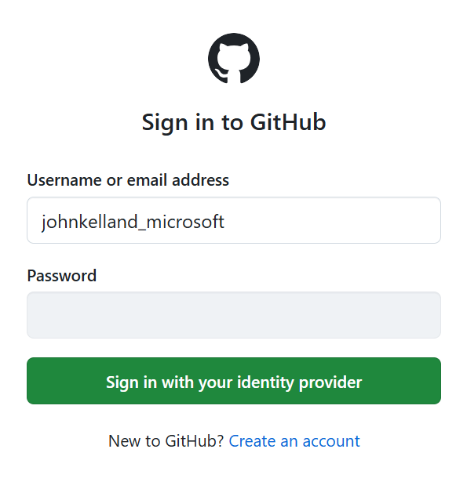
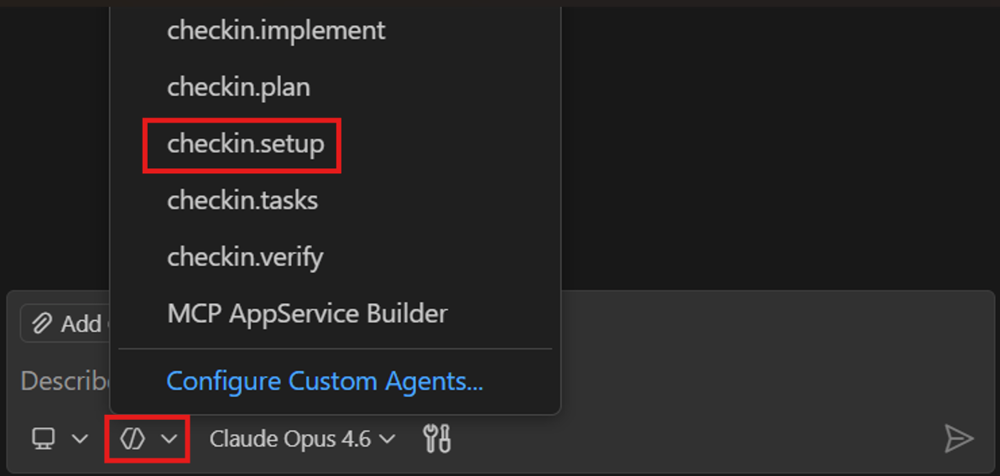
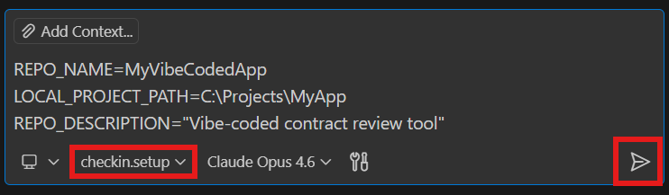

# Check-In Agent

The check-in agent automates the process of creating (or updating) an Azure DevOps repository and pushing local project files into it. This guide walks you through the prerequisites and steps required to use the agent.

## Prerequisites

### 1. Request Access to the CELA_Demos_and_POCs Project

Before using the check-in agent, you must have access to the **CELA_Demos_and_POCs** project in Azure DevOps. Please request membership in the [CELA Demos and POCs](https://coreidentity.microsoft.com/manage/Entitlement/entitlement/celademosand-gty3) entitlement in CoreIdentity.

> **Note:**

> **CELA Users:** If you intend to create a new repository, or push commits to an existing repository, you must request the **CELA - Contributor** role. If you only need to review existing code bases, you can request the **CELA - Reader** role.

> **MSFT (Non-CELA) Users:** If you are not a member of CELA, you must request the **MSFT (Non-CELA) - Reader** role.

### 2. Install Visual Studio Code

Download and install [Visual Studio Code](https://code.visualstudio.com/) if you do not already have it installed.

### 3. Install the GitHub Copilot Extension

1. Open Visual Studio Code.
2. Navigate to the **Extensions** view (`Ctrl+Shift+X`).
3. Search for **GitHub Copilot** and install the extension published by GitHub.
4. Sign in with your GitHub Enterprise Managed User (EMU) account when prompted.
   - Navigate to [GitHub Login](https://github.com/login)
   - Use `{alias}_microsoft` as your username
   - Select "Sign in with your identity provider"
   - Once you reach "Single sign-on to Microsoft EMU", select "Continue"



## Setup

### 4. Add the PlatformAgents Submodule to Your Local Repository

The check-in agent files must be available in your local project's `.agents\spear` folder so that GitHub Copilot can discover them. The recommended approach is to add the PlatformAgents repository as a **git submodule**, which keeps the agents in sync and allows you to bring in your own custom agents alongside.

1. From the root of your local project, run:

   ```
   git submodule add https://dev.azure.com/oneCELA/CELA_Demos_and_POCs/_git/PlatformAgents .agents/spear
   git submodule update --init --recursive
   ```

2. Your project structure should resemble the following:

   ```
   YourProject\
   ├── .agents\
   │   └── spear\                          ← PlatformAgents submodule
   │       └── checkin\
   │           ├── checkin.setup.agent.md
   │           ├── checkin.plan.agent.md
   │           ├── checkin.tasks.agent.md
   │           ├── checkin.implement.agent.md
   │           └── checkin.verify.agent.md
   ├── src\
   └── ...
   ```

> **Tip:** To update the agents to the latest version later, run `git submodule update --remote .agents/spear`.

## Usage

### 5. Open a GitHub Copilot Chat Window

In Visual Studio Code, open the GitHub Copilot chat panel by pressing `Ctrl+Shift+I` or by clicking the Copilot icon in the activity bar.

### 6. Select the Check-In Setup Agent

In the Copilot chat window, invoke the check-in setup agent by typing:

```
/checkin.setup
```

*or* selecting the agent:



### 7. Provide the Requested Arguments

The agent will prompt you for the following information:

| Argument | Description | Example |
|---|---|---|
| **Repository Name** | The name of the repository to create (or commit into) in Azure DevOps. | `MyVibeCodedApp` |
| **Local Project Path** | The absolute path to the local project directory containing the files to commit. | `C:\Projects\MyApp` |
| **Repository Description** | A short description for the repository. Required only when creating a new repository. | `Vibe-coded contract review tool` |

You may provide all arguments inline:

```
/checkin.setup REPO_NAME=MyVibeCodedApp LOCAL_PROJECT_PATH=C:\Projects\MyApp REPO_DESCRIPTION="Vibe-coded contract review tool"
```

*or* as your initial prompt to the agent:



Alternatively, the agent will ask for any missing values interactively.

> **Tip:** If the repository already exists in Azure DevOps, the agent will detect it automatically and skip repository creation. In that case, a repository description is not required.

## What Happens Next

Once you provide the required arguments, the check-in agent will automatically proceed through the following phases:

1. **Secret Detection** — Scans your local project for hardcoded secrets and stops the workflow if any are found.
2. **Repository Setup** — Creates the Azure DevOps repository (if it does not already exist) or verifies the existing one.
3. **Local Git Initialization** — Initializes a local Git repository (if needed) and ensures a `.gitignore` file is present.
4. **Stage and Commit** — Stages all files and creates a commit.
5. **Remote Configuration and Push** — Configures the remote origin and pushes the commit to Azure DevOps.
6. **Post-Check-In Validation** — Verifies the repository and branch are accessible in Azure DevOps.

No manual intervention is required unless the agent encounters secrets in your code or merge conflicts with the remote repository.