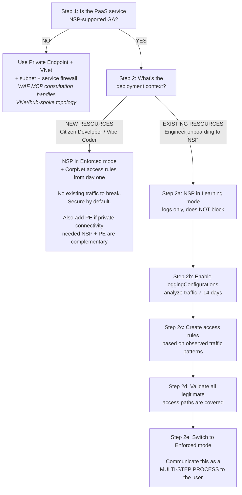

# Network Isolation Decision Tree

**Agent: Load this document when designing any Azure PaaS resource to determine the correct network isolation strategy.**

---

## SFI NS2.1 / NS2.2.1 Requirements

**NS2.1: Protect Networks**  
All Microsoft services must restrict public network exposure to critical data.

**NS2.2.1: Secure PaaS Resources**  
Specifically targets Storage Accounts, Key Vaults, SQL Database servers, Cosmos DB accounts.

**Origin**: Midnight Blizzard attack (2023) demonstrated need for defense-in-depth network isolation.

**Compliance**: A resource is compliant if **ANY ONE** of:
- (a) Public network access disabled + Private Endpoint/Private Link
- (b) Associated to Network Security Perimeter (NSP)
- (c) Approved S360 exception (rare; requires business justification)

---

## Decision Tree (PERSONA-AWARE)

> **CRITICAL**: Original NS2.2.1 guidance assumes EXISTING resources where Enforced mode could break live traffic. VibeShield creates NEW resources — different security posture.

**Key Decision Rule**: NSP in `Learning` mode (called "Transition mode" in TSG) does **nothing** to protect the resource — it only logs. For greenfield resources with no existing traffic, Learning mode is security theater. **Default to Enforced for all new deployments.**

---

## PaaS NSP Support Matrix

**Last verified**: 2026-04-19  
**Source**: [Onboarded private link resources](https://learn.microsoft.com/en-us/azure/private-link/network-security-perimeter-concepts#onboarded-private-link-resources)

### GA-Supported (Production-Ready)

Source: [Onboarded private link resources](https://learn.microsoft.com/en-us/azure/private-link/network-security-perimeter-concepts#onboarded-private-link-resources)

| Service | Resource Type | Notes |
|---------|-------------|-------|
| Azure Storage (Blob, File, Queue, Table) | `Microsoft.Storage/storageAccounts` | Azure Backup not compatible when fully NSP-locked |
| Azure Key Vault | `Microsoft.KeyVault/vaults` | PE traffic bypasses NSP evaluation |
| Event Hubs | `Microsoft.EventHub/namespaces` | Namespace-level association |
| Azure Service Bus | `Microsoft.ServiceBus/namespaces` | All tiers. Geo-DR requires both namespaces in same NSP. [Docs](https://learn.microsoft.com/en-us/azure/service-bus-messaging/network-security-perimeter) |
| Azure Monitor | `Microsoft.Insights/*`, `Microsoft.OperationalInsights/workspaces` | Log Analytics, DCR/DCE, Alerts. Action Groups must be regional |
| Azure AI Search | `Microsoft.Search/searchServices` | Full GA support |
| Microsoft Foundry | `Microsoft.CognitiveServices` (kind="AIServices") | GA. [Docs](https://learn.microsoft.com/en-us/azure/ai-foundry/how-to/add-foundry-to-network-security-perimeter) |

### Preview / Limited Support

| Service | Resource Type | Notes |
|---------|-------------|-------|
| Azure SQL Database | `Microsoft.Sql/servers` | Public Preview. Proxy connection policy only (not Redirect) |
| Azure Cosmos DB | `Microsoft.DocumentDB/databaseAccounts` | Public Preview; behavior varies by API |
| Azure OpenAI | `Microsoft.CognitiveServices` (kind="OpenAI") | Public Preview; approved regions |

### Not Verified — No Official NSP Docs

> **Agent guidance:** These services appeared in earlier researcher notes but are NOT in the [official onboarded list](https://learn.microsoft.com/en-us/azure/private-link/network-security-perimeter-concepts#onboarded-private-link-resources) and have no dedicated NSP documentation. Treat as unsupported until verified. Use PE + VNet.

- Azure Cache for Redis
- Azure Data Factory
- API Management
- Azure Container Apps
- Azure Databricks

### Not Supported (Use PE + VNet)

- App Service / Azure Functions
- Azure Database for MySQL / PostgreSQL
- Azure Container Registry
- Any PaaS not explicitly listed above

**Decision Rule**: If GA-supported → NSP Enforced. If Preview → NSP with explicit comment noting preview status. If "Not Verified" → treat as unsupported until confirmed; use PE + VNet. If Not Supported → PE + VNet + service firewall.

---

## NSP vs. Private Endpoints

| Aspect | NSP | Private Endpoint |
|--------|-----|------------------|
| **Purpose** | Governs public access boundary | Provides private connectivity via VNet |
| **Traffic evaluated** | Public ingress only | Private VNet traffic (NOT evaluated by NSP) |
| **Relationship** | Complementary — use both for public + private scenarios | Complementary — PE traffic bypasses NSP |
| **Management** | Centralized; resource owners can't bypass | Decentralized; requires VNet design |
| **Security posture** | Stronger than resource firewalls (no "Trusted Services" bypass) | Strong but requires correct subnet/NSG design |

**Key Insight**: NSP and PE are **not mutually exclusive**. If a resource needs both public (e.g., CI/CD pipelines) and private (e.g., app connectivity) access, implement BOTH.

> **WARNING**: NSP is more secure than resource-level firewalls because it's centrally managed and can't be bypassed by resource owners (e.g., SQL "Allow all Azure services" rule, Storage "Trusted Services" exposing ~100 services).

---

## Default Posture Rules

1. **All resources network-isolated from creation** — no exceptions without documented justification in Bicep comments
2. **No high-risk ports open to Internet** — use NSP or PE + NSG
3. **No direct storage/data access without BOTH authentication AND network isolation** — network isolation is the second factor
4. **For NSP-supported services**: Default to Enforced mode for new resources; only use Learning mode when onboarding existing resources with live traffic

---

## Sources

- **NS2.2.1 TSG Overview**: https://eng.ms/docs/cloud-ai-platform/azure-core/azure-networking/networking-control-plane-xinyanz/azure-virtual-network-manager/network-security-perimeters/articles/ns22tsg/ns22tsgoverview
- **NSP Support Matrix**: https://aka.ms/nspcopilot
- **Azure Verified Modules NSP Patterns**: https://azure.github.io/Azure-Verified-Modules/ (search "network security perimeter")
- **SFI Network Isolation Requirements**: https://eng.ms/docs/cloud-ai-platform/azure-security/secure-future-initiative/sfi-requirements

---

**Version**: 1.0 | **Last Updated**: 2026-04-19
